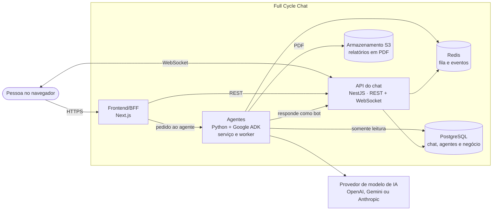

# Full Cycle Chat


Chat de equipe no estilo Slack, com canais, conversas 1:1, menções, tarefas e notificações em tempo
real, em que **agentes de IA entram como plugins**. Basta mencionar o `@assistente` na conversa para
ele resumir o que aconteceu, delegar uma tarefa para alguém ou responder perguntas sobre os números
do negócio direto do banco de dados da empresa.

> 🚧 **Em desenvolvimento.** O produto está especificado por inteiro em `docs/`, e o código avança
> funcionalidade a funcionalidade. Veja o [roadmap](docs/roadmap.md) para saber o que já existe.

## Objetivo

Times que trabalham pelo chat perdem contexto no volume de mensagens, e pedidos feitos na conversa
ficam sem dono. Perguntas sobre os números do negócio dependem de alguém com acesso ao banco. O Full
Cycle Chat resolve os três problemas dentro do próprio chat, sem trocar de ferramenta e sem expor os
dados da empresa a um assistente externo.

## O que o produto faz

- 💬 **A IA fica dentro da conversa.** Mencione o agente em qualquer canal ou conversa direta; o
  pedido e a resposta ficam ali mesmo.
- ✅ **O agente executa ações.** A delegação vira uma tarefa de verdade, com responsável e
  notificação, e o relatório de dados chega como PDF para baixar.
- 🔐 **Dados de negócio com permissão.** O agente só consulta dados quando quem pediu tem acesso, e
  nunca altera os dados da empresa.
- 🎯 **O agente não inventa.** Todo número precisa vir do resultado de uma consulta. Quando não
  consegue responder, ele diz que não conseguiu.
- 🔌 **Agentes são plugins.** Um administrador conecta e desconecta cada agente do workspace.

Escopo do MVP, público e métricas estão no [product brief](docs/product-brief.md).

## Arquitetura

Monorepo com três aplicações: o frontend/BFF em Next.js, a API do chat em NestJS e os agentes em
Python com Google ADK. A decisão central é o **chat não depender dos agentes**: o BFF dispara o
agente, e o agente devolve a resposta à conversa como um bot, pela mesma API que as pessoas usam.



O diagrama completo, os fluxos e as decisões estão no [HLD](docs/hld.md).

## Como executar

**Pré-requisito:** [Docker](https://docs.docker.com/get-docker/) com Docker Compose. Tudo roda
dentro dos contêineres, então você não precisa de Node.js nem pnpm instalados na máquina.

```bash
git clone https://github.com/helloWorldRuan/fullcycle-slack-ia.git
cd fullcycle-slack-ia

# Sobe os contêineres e espera o Postgres e o S3 ficarem prontos
docker compose -f compose.yaml up -d --build --wait
```

Na primeira subida, a instalação das dependências continua dentro dos contêineres por alguns
minutos. Acompanhe com `docker compose -f compose.yaml logs -f web chat-api` e, quando terminar,
rode a web e a API (cada uma num terminal):

```bash
docker compose -f compose.yaml exec web pnpm dev --hostname 0.0.0.0
docker compose -f compose.yaml exec chat-api pnpm start:dev
```

| Serviço | Endereço |
| --- | --- |
| Web (Next.js) | <http://localhost:3000> |
| API do chat (NestJS) | <http://localhost:3001> |
| PostgreSQL | `localhost:5432` |
| S3 (SeaweedFS) | <http://localhost:8333> |

Para derrubar: `docker compose -f compose.yaml down`.

Recomeçar do zero, resolver falha na instalação e os comandos de teste e lint de cada aplicação
estão no [`AGENTS.md`](AGENTS.md), em [`apps/chat-api/AGENTS.md`](apps/chat-api/AGENTS.md) e em
[`apps/web/AGENTS.md`](apps/web/AGENTS.md).

## Como o projeto é organizado

O repositório começa pela documentação. Antes de qualquer código, o produto e a arquitetura são
escritos em documentos, e esses documentos guiam os agentes de código.

1. **Product brief.** O [`docs/product-brief.md`](docs/product-brief.md) define o quê, para quem e
   o que fica fora do MVP.
2. **HLD.** O [`docs/hld.md`](docs/hld.md) traz a arquitetura de alto nível: contêineres, fluxos e
   requisitos de qualidade.
3. **LLD e ADRs.** O [`docs/lld.md`](docs/lld.md) desce aos detalhes (rotas, tabelas, regras), e
   cada decisão importante vira um ADR em [`docs/adr/`](docs/adr/).
4. **Funcionalidades.** O [`docs/roadmap.md`](docs/roadmap.md) lista o que será entregue, na ordem
   de dependência. Cada uma tem PRD, spec e tarefas em `docs/funcionalidades/`.
5. **Memória dos agentes.** O [`AGENTS.md`](AGENTS.md) e as rules de cada aplicação trazem comandos,
   forma de rodar no Docker e práticas de código. O agente lê esses arquivos antes de trabalhar.

Skills usadas no projeto (ficam em `.claude/skills/`):

| Skill | Para quê | Origem |
| --- | --- | --- |
| `product-brief` | Entrevista e grava o product brief | Própria do projeto |
| `hld` | Cria, revisa e atualiza o HLD | Própria do projeto |
| `lld` | Cria, revisa e atualiza o LLD | Própria do projeto |
| `domain-modeling` | Glossário do domínio e ADRs | [mattpocock/skills](https://github.com/mattpocock/skills) |
| `grill-me`, `grilling`, `grill-with-docs` | Entrevistas para testar ideias e planos | [mattpocock/skills](https://github.com/mattpocock/skills) |
| `nestjs-best-practices` | Boas práticas de NestJS | [kadajett/agent-nestjs-skills](https://github.com/kadajett/agent-nestjs-skills) |
| `next-best-practices` | Boas práticas de Next.js | [vercel-labs/openreview](https://github.com/vercel-labs/openreview) |
| `vercel-react-best-practices` | Performance em React e Next.js | [vercel-labs/agent-skills](https://github.com/vercel-labs/agent-skills) |

## Onde ler o quê

| Documento | O que tem |
| --- | --- |
| [`docs/product-brief.md`](docs/product-brief.md) | O quê e para quem: escopo do MVP, o que fica fora, métricas |
| [`docs/hld.md`](docs/hld.md) | Arquitetura de alto nível: contêineres, fluxos, requisitos |
| [`docs/lld.md`](docs/lld.md) | Detalhes de implementação: rotas, tabelas, regras |
| [`docs/adr/`](docs/adr/) | As decisões de arquitetura, uma por arquivo |
| [`docs/roadmap.md`](docs/roadmap.md) | As funcionalidades a desenvolver, as dependências e o status de cada uma |
| [`GLOSSARY.md`](GLOSSARY.md) | O vocabulário do domínio |
| [`AGENTS.md`](AGENTS.md) | Como rodar o projeto e as convenções para agentes de código |

## Licença

Distribuído sob a licença MIT. Veja o arquivo [`LICENSE`](LICENSE).
